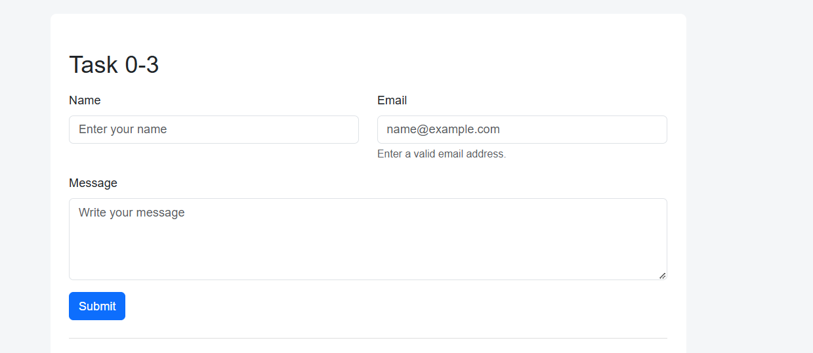
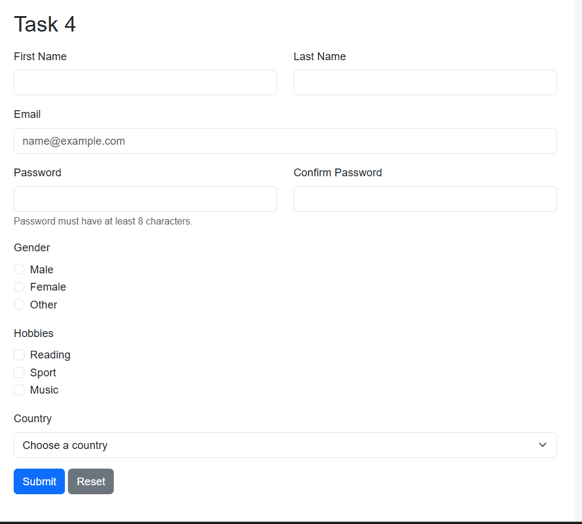

# Assignment #4 — Forms and Validation

**Name:** Isaali Abdunabi  
**Group:** IT-2502

## Task 0–3: Contact Form and Validation

I created a contact form with name, email and message fields.

I used HTML5 validation attributes like `required`, `type="email"` and `maxlength`.

I used Bootstrap classes to style the form. I also added examples of valid and invalid email fields with feedback messages.

**Screenshot:**

## Task 4: Registration Form

I created a registration form with the following fields:

- First Name
- Last Name
- Email
- Password
- Confirm Password
- Gender
- Hobbies
- Country

I added Submit and Reset buttons. I used Bootstrap Grid to make the form responsive.

I also added HTML5 validation. The password must have at least 8 characters.

**Screenshot:**

## Summary

In this assignment, I learned how to create HTML forms and use Bootstrap classes. I practised HTML5 validation and added feedback messages for form fields.

I completed the project using HTML, CSS and Bootstrap.
